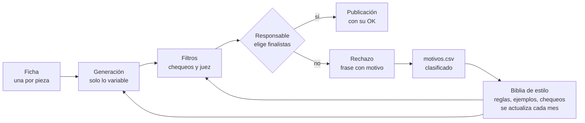

# Se corrige una vez

**Produce contenido con IA sin correcciones infinitas.**
[Read in English](README.md)

Cada corrección se hace una sola vez: sobre el sistema, no sobre la pieza. Cuando el responsable de un canal rechaza algo, ese rechazo se convierte en una regla, un ejemplo o un chequeo automático, y no vuelve a pedirse.

Es un kit gratuito para creadores y equipos pequeños que producen mucho y con un formato que se repite: canales de música o de letras, canales sin cara, podcasts que sacan clips cada semana, series educativas, agencias que producen para varios clientes. Funciona mejor cuando hay alguien exigente con el resultado, porque su criterio es justamente lo que el sistema captura.

## Los cinco pasos

1. **Una biblia de estilo** en dos formatos: uno que lee una persona y otro que lee una máquina.
2. **Una ficha completa por pieza.** Sin ficha no se produce nada.
3. **Plantillas** para todo lo que debe verse igual. La IA genera solo lo que cambia.
4. **Dos filtros** antes de que el responsable vea algo: chequeos medibles y un juez visual que descarta, pero nunca aprueba.
5. **Cada rechazo se anota** con su motivo y, una vez al mes, se convierte en regla.

El responsable pasa de revisar todo a elegir entre 2 o 3 finalistas por pieza.

## Qué hay en el repositorio

| Carpeta | Qué es |
| --- | --- |
| [`es/`](es/) | El kit completo en español: plantillas de la biblia, ficha, script de chequeos, bloqueo de publicación, cuatro skills para Claude Code y el agente juez |
| [`en/`](en/) | El mismo kit en inglés |
| [`docs/GUIA.md`](docs/GUIA.md) | La guía paso a paso en español |
| [`docs/GUIDE.md`](docs/GUIDE.md) | La guía en inglés |
| [`tests/`](tests/) | Pruebas automáticas del script de chequeos y del bloqueo |

## Cómo empezar

1. Haz clic en **Use this template** para crear tu propia copia (o descarga el zip de tu idioma desde [Releases](../../releases)).
2. Quédate con la carpeta de tu idioma y mueve su contenido a la raíz de tu repositorio. Borra la otra.
3. Abre el repositorio con [Claude Code](https://docs.claude.com/en/docs/claude-code/overview) y sigue el README de la carpeta de tu idioma.

Requisitos: Claude Code, Python 3.9 o más reciente y FFmpeg. Opcional: conectores MCP de tus herramientas de generación (Runway, Krea, ComfyUI), de Adobe y de tu almacenamiento.

## Una advertencia sobre la monetización

La plantilla fija la identidad visual, nunca la estructura ni la idea de cada pieza. YouTube no monetiza los canales cuyo contenido parece hecho con una plantilla o se siente intercambiable de un video a otro. Es su política de "contenido inauténtico", que se llamaba "contenido repetitivo" hasta el 15 de julio de 2025 y que aclaró de nuevo en julio de 2026. Revisa la versión vigente en el [Centro de ayuda de YouTube](https://support.google.com/youtube/answer/1311392).

## Licencia

El código (scripts, hook, skills, agente) va con [licencia MIT](LICENSE). Las guías y plantillas de texto, con [CC BY 4.0](LICENSE-DOCS.md). Úsalo, adáptalo y compártelo; por favor cita la fuente.

Hecho por [Ramon Sanchez-Castillo](https://www.linkedin.com/in/ramonsanve).
