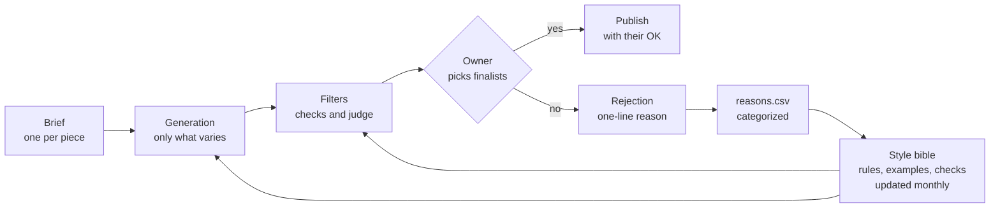

# Fix It Once

**Produce AI-assisted content without endless revisions.**
[Leer en español](README.es.md)

Every correction is made once: on the system, not on the piece. When the person in charge of a channel rejects something, that rejection becomes a rule, an example or an automatic check, and it never has to be asked for again.

This is a free kit for creators and small teams who produce a lot in a repeatable format: music and lyric channels, faceless channels, podcasts that cut clips every week, educational series, agencies producing for several clients. It works best when someone is demanding about the result, because their judgment is exactly what the system captures.

## The five steps

1. **A style bible** in two formats: one a person reads, one a machine reads.
2. **A complete brief per piece.** No brief, no production.
3. **Templates** for everything that must look the same. AI generates only what changes.
4. **Two filters** before the owner sees anything: measurable checks and a visual judge that discards but never approves.
5. **Every rejection is logged** with its reason and, once a month, becomes a rule.

The owner goes from reviewing everything to choosing between 2 or 3 finalists per piece.

## What's in the repository

| Folder | What it is |
| --- | --- |
| [`en/`](en/) | The complete kit in English: bible templates, brief, checks script, publishing hook, four Claude Code skills and the judge agent |
| [`es/`](es/) | The same kit in Spanish |
| [`docs/GUIDE.md`](docs/GUIDE.md) | The step-by-step guide in English |
| [`docs/GUIA.md`](docs/GUIA.md) | The guide in Spanish |
| [`tests/`](tests/) | Automated tests for the checks script and the hook |

## Quick start

1. Click **Use this template** to create your own copy (or download the zip for your language from [Releases](../../releases)).
2. Keep the folder for your language and move its contents to the root of your repository. Delete the other one.
3. Open the repository with [Claude Code](https://docs.claude.com/en/docs/claude-code/overview) and follow the language folder's README.

Requirements: Claude Code, Python 3.9+ and FFmpeg. Optional: MCP connectors for your generation tools (Runway, Krea, ComfyUI), Adobe and your storage.

## A warning about monetization

The template fixes the visual identity, never the structure or the idea of each piece. YouTube does not monetize channels whose content looks template-made or feels interchangeable from video to video. That is its "inauthentic content" policy, renamed from "repetitious content" on July 15, 2025 and clarified again in July 2026. Check the current version in the [YouTube Help Center](https://support.google.com/youtube/answer/1311392).

## License

Code (scripts, hook, skills, agent) under the [MIT License](LICENSE). Guides and text templates under [CC BY 4.0](LICENSE-DOCS.md). Use it, adapt it and share it; please credit the source.

Made by [Ramon Sanchez-Castillo](https://www.linkedin.com/in/ramonsanve).
