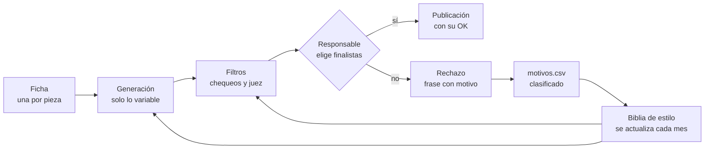

# Se corrige una vez: guía para producir contenido con IA sin correcciones infinitas

[Read in English](GUIDE.md)

## La idea

Cada corrección se hace una sola vez: sobre el sistema, no sobre la pieza. Si el responsable rechaza algo, ese rechazo se convierte en una regla, un ejemplo o un chequeo automático, y no vuelve a pedirse.

Esta guía es para creadores y equipos pequeños que producen mucho y con un formato que se repite: canales de música o de letras, canales sin cara, podcasts que sacan clips cada semana, series educativas, agencias que producen para varios clientes. Funciona mejor cuando hay alguien exigente con el resultado, porque su criterio es justamente lo que el sistema captura.

El método salió de rediseñar el proceso de producción de un canal de alto volumen que publica varios formatos por pieza cada mes. Los ejemplos usan un canal de música porque muestra el ciclo completo, del archivo de origen a los clips y las miniaturas, pero el método no depende de ningún formato ni herramienta en particular.

## Por qué la IA sola no reduce las correcciones

La IA acelera la producción, pero si el criterio sigue viviendo solo en la cabeza de una persona, esa persona termina revisando más, no menos. Las causas se repiten en casi todos los equipos:

- **El estilo no está escrito.** Cada pieza se juzga contra una idea que nadie más ve, así que la IA acierta por casualidad.
- **Cada pieza arranca de la anterior.** Copiar el proyecto pasado arrastra errores viejos que hay que volver a cazar.
- **Se revisa todo, incluso lo medible.** Duraciones, nombres o textos que se salen del cuadro se revisan a ojo, cuando una máquina los detecta sola.
- **Los rechazos se pierden.** El "esto no" se dice una vez y se olvida; la semana siguiente vuelve el mismo error.
- **Más variantes, más revisión.** Generar 20 opciones en vez de 3 multiplica el trabajo de quien elige.

## Cómo funciona

La biblia alimenta la generación y los filtros. Por eso, con cada mes de rechazos registrados, al responsable le llegan menos piezas que corregir.

## Paso 1: la biblia de estilo

La biblia es una carpeta que guarda el gusto del responsable en dos formatos a la vez: uno que lee una persona y otro que lee una máquina. Se arma en una o dos semanas y ahorra correcciones durante meses.

| Archivo | Para qué sirve | Quién lo lee |
| --- | --- | --- |
| `estilo.yaml` | Reglas medibles: paleta en hex, formato, zona reservada para el texto, prompt base y negativo, variaciones por emoción o tema | El agente y los chequeos |
| `BIBLIA.md` | Las mismas reglas con su porqué y un ejemplo sí y uno no por regla | Personas del equipo |
| `CHANGELOG.md` | Qué regla cambió, cuándo y por qué rechazo | El responsable |
| `referencias/si` y `referencias/no` | Imágenes o frames aprobados y rechazados | El juez automático y el entrenamiento de un modelo propio |
| `referencias/no/motivos.csv` | Una fila por rechazo, con su categoría | El juez automático |

Cómo armarla:

1. **Audita lo que ya existe.** Junta 30 a 50 piezas o frames del canal y sepáralos en sí, no y casi. Escribe una frase por cada no y cada casi. Esas frases son la primera versión de las reglas.
2. **Haz una prueba de estrés.** Genera las mismas 6 escenas (alegre, triste, de noche, con grupo, etc.) en 2 o 3 direcciones posibles y elige una. Un estilo que solo funciona en la escena bonita no sirve.
3. **Escribe reglas que se puedan medir.** "Luz cálida" no sirve; "luz lateral dorada, color dominante #D9A55B" sí. La prueba: si dos personas la aplican y les da lo mismo, la regla está lista.
4. **Define variaciones por tema o emoción.** Una tabla cerrada de cómo cambia la imagen según el contenido. Es la sección que más discusiones evita.
5. **Valida a ciegas.** Genera 20 piezas solo con la biblia. Si el responsable aprueba menos de la mitad sin tocarlas, falta alguna regla.

Cuando pasa la prueba, la biblia queda como versión 1.0 y solo cambia una vez al mes.

## Paso 2: una ficha por pieza

Cada pieza entra al sistema con una ficha completa: una fila en una hoja de cálculo o un archivo `pieza.json`. Sin ficha completa no se produce nada. Así se acaban las preguntas a mitad del trabajo.

Lo que lleva una ficha típica:

- título en su forma final, ya revisado contra la regla de nombres;
- archivos de origen: audio, texto o guion, fondo o imagen principal;
- textos derivados: citas, frases para clips, título de la miniatura;
- decisiones de edición: qué fragmento va al formato corto, qué tema o emoción aplica;
- canal o serie, si el equipo produce para más de uno.

El agente valida la ficha al recibirla, antes de construir: que el título cumpla la regla, que cada cita aparezca literal en el texto, que los archivos tengan la resolución y la duración esperadas. Si algo falla, avisa en ese momento, no a mitad del montaje.

## Paso 3: plantillas y lotes

La IA genera solo lo que cambia en cada pieza. Lo que debe verse siempre igual sale de plantillas aprobadas una sola vez.

- **Plantilla maestra limpia, no la pieza anterior.** Cada pieza se construye desde una plantilla sin restos de ninguna otra, llenada con los datos de su ficha. En After Effects eso son propiedades de Essential Graphics; en código, una plantilla de Remotion o un script de FFmpeg.
- **El texto nunca lo pone un generador de imágenes.** Títulos, letras, citas y textos de miniatura salen de la plantilla, con la tipografía de la marca. Los modelos de imagen todavía fallan con acentos y frases largas.
- **Una pieza larga, muchos formatos.** Una canción da el video completo, clips verticales, citas y portadas; un episodio de podcast, el video, 3 clips y las miniaturas. La ficha dice qué fragmento va a cada formato.
- **Lo que no necesita un editor, fuera del editor.** Pegar videos ya renderizados para un mix largo es una concatenación con FFmpeg que tarda minutos, no un render de horas.
- **Por lotes.** Se construye todo el mes de un canal en una sesión, se revisa en una sola galería y se renderiza en una sola cola, de noche.

## Paso 4: control de calidad en dos capas

Antes de que el responsable vea nada, dos filtros descartan lo que no sirve.

**Capa 1: chequeos medibles.** Un script corre sobre cada archivo y no opina: mide.

- duración de cada formato contra su límite (por ejemplo, Reel 20 s o menos);
- resolución, fps y audio presente;
- nombres de archivo según la regla del canal;
- color dominante contra la paleta de la biblia, con tolerancia medida (ΔE de 2 o menos);
- texto dentro de las zonas seguras.

El kit trae `chequeos.py`, que revisa duración, resolución, fps, audio y nombres en los videos, y nombre y resolución en las miniaturas. Los chequeos de color y de zonas seguras todavía no vienen incluidos: son los siguientes que conviene agregar cuando tus rechazos muestren que hacen falta.

**Capa 2: un juez visual.** Un modelo de visión compara cada candidata con las referencias de sí y de no, descarta las que tienen defectos y ordena las demás. Tres reglas:

1. **El juez descarta y ordena, nunca aprueba.** Los modelos de visión son buenos comparando pares y malos dando una nota absoluta.
2. **Aprende de ejemplos del propio responsable.** Sin ejemplos, tiende a dar por buenas piezas con defectos; cuantos más rechazos con su motivo tenga, más detecta. Antes de confiar en él, compara sus descartes con los del responsable durante dos o tres lotes.
3. **Es un agente separado del que genera.** Un agente que revisa su propio trabajo tiende a aprobarlo.

Al responsable le llegan 2 o 3 finalistas por pieza, no 20.

## Paso 5: aprobaciones y registro de rechazos

**Puntos de aprobación.** Tres o cuatro por lote, siempre los mismos: la lista de piezas del mes, las finalistas, el corte final y la publicación. Lo que tiene costo se aprueba antes, con el costo a la vista. Nada se publica sin su visto bueno. En Claude Code un hook lo respalda: bloquea subidas, copias a carpetas de entrega y acciones de conectores cuando el archivo de aprobación del lote falta o está incompleto, e impide que Claude escriba ese archivo. Es una barrera contra errores, no un candado: el control sigue siendo el visto bueno del responsable.

**Cada rechazo, con su motivo.** Una frase basta: "la letra cae sobre los árboles y no se lee". El agente la anota en `motivos.csv` y la clasifica:

| Categoría | Ejemplo | Adónde va |
| --- | --- | --- |
| Defecto | Cara deformada, texto cortado | Chequeo automático o ejemplo para el juez |
| Preferencia | Cielo demasiado frío para una canción alegre | Regla nueva en la biblia |
| Capricho | "No me gusta el ángulo" | Se anota y no se convierte en nada |

**Reglas nuevas, una vez al mes.** Los pendientes se juntan y se aplican juntos, con una entrada en el `CHANGELOG`.

**Un límite sano.** Los defectos se corrigen siempre. Las preferencias tienen una ronda por pieza. El perfeccionismo sube las horas, no el resultado; el sistema lo canaliza hacia las reglas, no hacia cada pieza.

## Una semana tipo

| Momento | El responsable | El agente |
| --- | --- | --- |
| Lunes | Nada | Valida las fichas, genera variantes, corre los chequeos y el juez, y arma la galería de finalistas |
| Martes, 30 a 45 min | Elige una finalista por pieza y escribe una frase por cada rechazo | Anota los rechazos en `motivos.csv` |
| Miércoles, 15 min | Elige la miniatura entre 3 variantes | Construye todos los formatos desde las plantillas |
| Jueves | Revisa el corte en una sola sesión y aprueba el lote | Renderiza de noche y corre el control de calidad final |
| Viernes | Da el OK de publicación | Entrega, programa y deja el correo listo |
| Una vez al mes, 10 min | Aprueba o rechaza las reglas propuestas | Propone los cambios a la biblia y al `CHANGELOG` |

Los tiempos son una referencia. Mide los tuyos durante el primer mes.

## Cómo usar el kit con Claude y Claude Code

1. **Copia la carpeta `es/`** a un repositorio nuevo y ábrela con Claude Code.
2. **Llena la biblia** siguiendo el paso 1.
3. **Ajusta `CLAUDE.md`** con el nombre de tu canal, tus formatos y dónde se entrega cada cosa.
4. **Usa las cuatro skills** de `.claude/skills/`: `generar-piezas`, `revisar-piezas`, `registrar-rechazo` y `proponer-reglas`.
5. **El juez es un agente aparte** (`.claude/agents/juez.md`), con su propio contexto.
6. **Conecta tus herramientas por MCP** si las usas: generadores de imagen y video, Adobe, Drive o Dropbox.
7. **Sube la biblia como skill también en la app de Claude**, para que Claude conozca tus reglas cuando converses sobre una pieza.

## El riesgo: contenido repetitivo

El mismo sistema que ahorra correcciones puede producir piezas casi idénticas, y eso es lo que YouTube deja sin monetizar. El 15 de julio de 2025 renombró su política de "contenido repetitivo" como "contenido inauténtico" y precisó que incluye el contenido repetitivo o producido en masa. En julio de 2026 lo aclaró de nuevo: no se monetiza el contenido genérico, repetitivo o hecho con plantillas que varía poco de un video a otro.

Su Centro de ayuda dice que no se monetizan los canales cuyo contenido parece hecho con una plantilla o se siente intercambiable de un video a otro. La consecuencia no es borrar los videos, sino perder el acceso al Programa de socios mientras dure la infracción.

- **La plantilla fija la identidad visual:** tipografía, colores, posición del texto, marca.
- **Nunca fija la estructura ni la idea:** cada pieza tiene su tema, su imagen, su orden y su aporte propio.
- **Nada se recicla dentro de la misma pieza** para estirar la duración.

Si alguien que ve dos videos seguidos del canal no puede decir en qué se diferencian, el sistema está produciendo de más.

## Fuentes

- [Políticas de monetización de canales de YouTube](https://support.google.com/youtube/answer/1311392?hl=es), Centro de ayuda de YouTube, consultado el 18 de noviembre de 2026.
- [YouTube clarifies policies around AI slop and upsetting videos](https://techcrunch.com/2026/07/20/youtube-clarifies-policies-around-ai-slop-and-upsetting-videos/), TechCrunch, 20 de julio de 2026.
