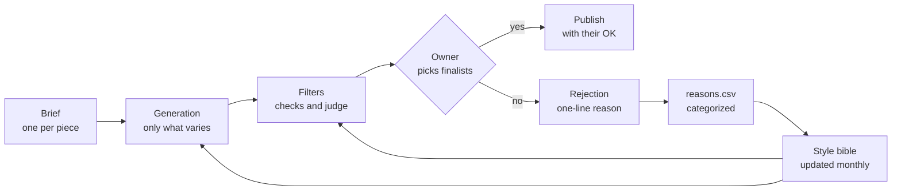

# Fix It Once: a guide to producing AI-assisted content without endless revisions

[Leer en español](GUIA.md)

## The idea

Every correction is made once: on the system, not on the piece. If the owner rejects something, that rejection becomes a rule, an example or an automatic check, and it never has to be asked for again.

This guide is for creators and small teams who produce a lot in a repeatable format: music and lyric channels, faceless channels, podcasts that cut clips every week, educational series, agencies producing for several clients. It works best when someone is demanding about the result, because their judgment is exactly what the system captures.

The method came out of redesigning the production process of a high-volume channel that publishes several formats per piece every month. The examples use a music channel because it shows the whole cycle, from the source file to the clips and thumbnails, but the method doesn't depend on any particular format or tool.

## Why AI alone doesn't reduce revisions

AI speeds up production, but if judgment still lives only in one person's head, that person ends up reviewing more, not less. The causes repeat in almost every team:

- **The style isn't written down.** Every piece is judged against an idea nobody else can see, so the AI gets it right by chance.
- **Every piece starts from the last one.** Copying the previous project drags old errors along that have to be hunted down again.
- **Everything gets reviewed, even what's measurable.** Durations, names or text running off the frame are checked by eye when a machine would catch them on its own.
- **Rejections get lost.** "Not this" is said once and forgotten; next week the same mistake is back.
- **More variants, more review.** Generating 20 options instead of 3 multiplies the work of whoever chooses.

## How it works

The bible feeds both generation and the filters. That's why every month of logged rejections means fewer pieces reach the owner for correction.

## Step 1: the style bible

The bible is a folder that holds the owner's taste in two formats at once: one a person reads and one a machine reads. It takes one or two weeks to build and saves revisions for months.

| File | What it's for | Who reads it |
| --- | --- | --- |
| `style.yaml` | Measurable rules: hex palette, aspect ratio, reserved text zone, base and negative prompt, variations by emotion or theme | The agent and the checks |
| `BIBLE.md` | The same rules with their reason and one yes and one no example each | The team |
| `CHANGELOG.md` | Which rule changed, when and because of which rejection | The owner |
| `references/approved` and `references/rejected` | Approved and rejected images or frames | The automatic judge and training your own model |
| `references/rejected/reasons.csv` | One row per rejection, with its category | The automatic judge |

How to build it:

1. **Audit what exists.** Gather 30 to 50 of the channel's pieces or frames and sort them into yes, no and almost. Write one sentence for each no and each almost. Those sentences are the first version of the rules.
2. **Run a stress test.** Generate the same 6 scenes (joyful, sad, night, group, etc.) in 2 or 3 possible directions and pick one. A style that only works on the pretty scene is no good.
3. **Write rules you can measure.** "Warm light" doesn't work; "golden side light, dominant color #D9A55B" does. The test: if two people apply it and get the same result, the rule is ready.
4. **Define variations by theme or emotion.** A closed table of how the image changes with the content. It's the section that prevents the most arguments.
5. **Validate blind.** Generate 20 pieces using only the bible. If the owner approves fewer than half without changes, a rule is missing.

Once it passes, the bible becomes version 1.0 and changes only once a month.

## Step 2: one brief per piece

Every piece enters the system with a complete brief: a spreadsheet row or a `piece.json` file. No complete brief, no production. That ends the mid-production questions.

A typical brief holds:

- the final title, already checked against the naming rule;
- source files: audio, text or script, background or main image;
- derived text: quotes, lines for clips, thumbnail title;
- editing decisions: which segment goes to the short format, which theme or emotion applies;
- channel or series, if the team produces for more than one.

The agent validates the brief on arrival, before building: the title follows the rule, every quote appears word for word in the text, the files have the expected resolution and duration. If something fails, it says so right then, not halfway through the edit.

## Step 3: templates and batches

AI generates only what changes in each piece. What must always look the same comes from templates approved once.

- **A clean master template, not the previous piece.** Each piece is built from a template with no leftovers from any other, filled with its brief's data. In After Effects that means Essential Graphics properties; in code, a Remotion template or an FFmpeg script.
- **Text never comes from an image generator.** Titles, lyrics, quotes and thumbnail text come from the template, in the brand's typeface. Image models still fail at accents and long phrases.
- **One long piece, many formats.** A song yields the full video, vertical clips, quotes and covers; a podcast episode yields the video, 3 clips and thumbnails. The brief says which segment goes to each format.
- **What doesn't need an editor stays out of the editor.** Joining already rendered videos into a long mix is an FFmpeg concat that takes minutes, not an hours-long render.
- **In batches.** A channel's whole month is built in one session, reviewed in one gallery and rendered in one overnight queue.

## Step 4: quality control in two layers

Before the owner sees anything, two filters discard what doesn't work.

**Layer 1: measurable checks.** A script runs on every file and has no opinions: it measures.

- each format's duration against its limit (for example, Reel 20 s or less);
- resolution, fps and audio presence;
- file names following the channel's rule;
- dominant color against the bible's palette, with a measured tolerance (ΔE of 2 or less);
- text inside the safe zones.

The kit includes `checks.py`, which checks duration, resolution, fps, audio and names for videos, and name and resolution for thumbnails. The color and safe-zone checks aren't included yet: they're the next ones to add when your rejections show they're needed.

**Layer 2: a visual judge.** A vision model compares each candidate with the approved and rejected references, discards the ones with defects and ranks the rest. Three rules:

1. **The judge discards and ranks; it never approves.** Vision models are good at comparing pairs and bad at absolute scores.
2. **It learns from the owner's own examples.** Without examples, it tends to pass pieces with defects; the more reasoned rejections it has, the more it catches. Before trusting it, compare its discards with the owner's for two or three batches.
3. **It's a separate agent from the generator.** An agent reviewing its own work tends to approve it.

The owner gets 2 or 3 finalists per piece, not 20.

## Step 5: approvals and the rejection log

**Approval points.** Three or four per batch, always the same: the month's list of pieces, the finalists, the final cut and publishing. Anything with a cost is approved first, with the cost shown. Nothing is published without the owner's OK. In Claude Code a hook backs this up: it blocks uploads, copies to delivery folders and connector actions when the batch's approval file is missing or incomplete, and it stops Claude from writing that file itself. It's a guardrail against mistakes, not a lock: the owner's OK is still the control.

**Every rejection, with its reason.** One sentence is enough: "the lyrics land on the trees and can't be read." The agent logs it in `reasons.csv` and categorizes it:

| Category | Example | Where it goes |
| --- | --- | --- |
| Defect | Deformed face, cut-off text | Automatic check or judge example |
| Preference | Sky too cold for a joyful song | New rule in the bible |
| Whim | "I don't like the angle" | Logged and turned into nothing |

**New rules, once a month.** Pending items are collected and applied together, with a `CHANGELOG` entry.

**A healthy limit.** Defects are always fixed. Preferences get one round per piece. Perfectionism raises hours, not results; the system channels it into the rules, not into each piece.

## A typical week

| When | The owner | The agent |
| --- | --- | --- |
| Monday | Nothing | Validates briefs, generates variants, runs the checks and the judge, and builds the finalists gallery |
| Tuesday, 30 to 45 min | Picks one finalist per piece and writes one sentence per rejection | Logs rejections in `reasons.csv` |
| Wednesday, 15 min | Picks the thumbnail from 3 variants | Builds every format from the templates |
| Thursday | Reviews the cut in one session and approves the batch | Renders overnight and runs the final quality check |
| Friday | Gives the publishing OK | Delivers, schedules and drafts the email |
| Once a month, 10 min | Approves or rejects the proposed rules | Proposes changes to the bible and the `CHANGELOG` |

The times are a reference. Measure yours during the first month.

## Using the kit with Claude and Claude Code

1. **Copy the `en/` folder** into a new repository and open it with Claude Code.
2. **Fill in the bible** following step 1.
3. **Adjust `CLAUDE.md`** with your channel's name, your formats and where everything is delivered.
4. **Use the four skills** in `.claude/skills/`: `generate-pieces`, `review-pieces`, `log-rejection` and `propose-rules`.
5. **The judge is a separate agent** (`.claude/agents/judge.md`), with its own context.
6. **Connect your tools through MCP** if you use them: image and video generators, Adobe, Drive or Dropbox.
7. **Upload the bible as a skill in the Claude app too**, so Claude knows your rules when you talk about a piece.

## The risk: repetitive content

The same system that saves revisions can produce near-identical pieces, and that's exactly what YouTube won't monetize. On July 15, 2025 it renamed its "repetitious content" policy to "inauthentic content" and clarified that it includes repetitive or mass-produced content. In July 2026 it clarified again: generic, repetitive or template-based content that varies little from one video to the next is not monetized.

Its Help Center says channels whose content looks template-made or feels interchangeable from video to video are not allowed to monetize. The consequence isn't removal, but losing access to the Partner Program while the violation lasts.

- **The template fixes the visual identity:** typeface, colors, text position, brand.
- **It never fixes the structure or the idea:** every piece has its own topic, image, order and contribution.
- **Nothing is recycled within the same piece** to stretch its length.

If someone watching two of the channel's videos in a row can't tell how they differ, the system is overproducing.

## Sources

- [YouTube channel monetization policies](https://support.google.com/youtube/answer/1311392?hl=en), YouTube Help Center, accessed November 18, 2026.
- [YouTube clarifies policies around AI slop and upsetting videos](https://techcrunch.com/2026/07/20/youtube-clarifies-policies-around-ai-slop-and-upsetting-videos/), TechCrunch, July 20, 2026.
